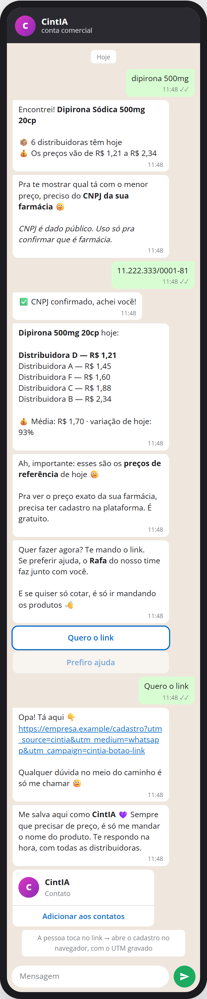
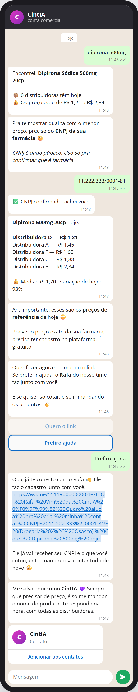
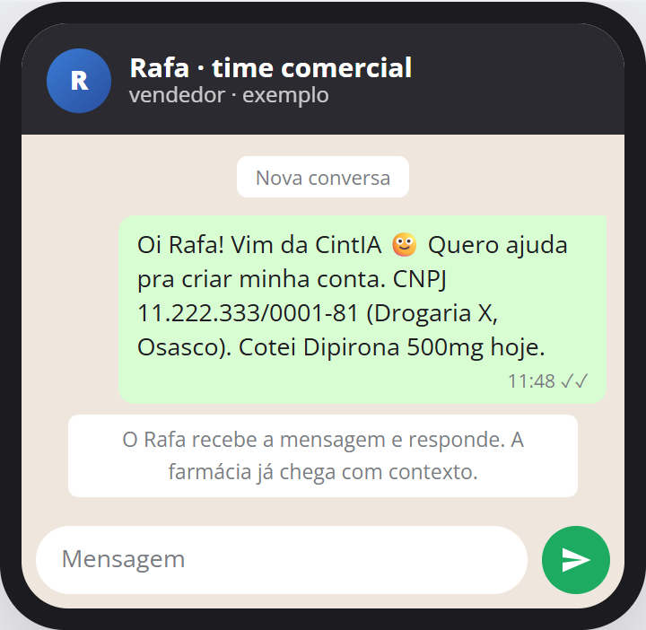
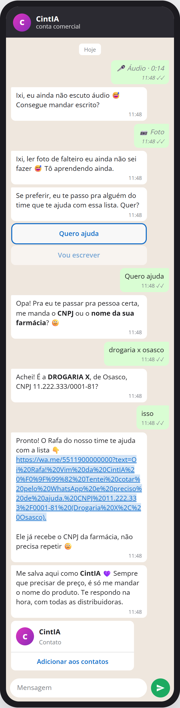
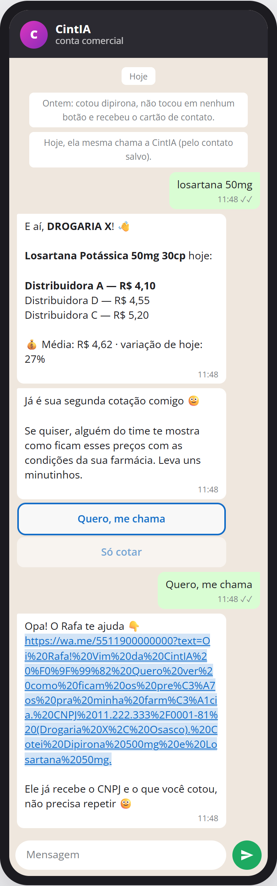
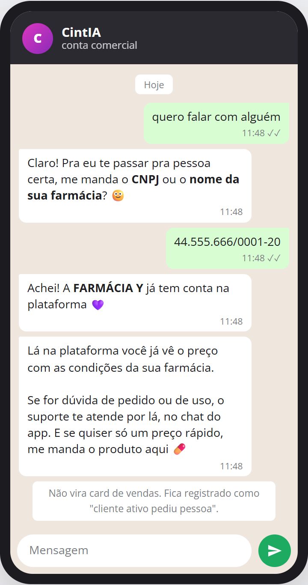
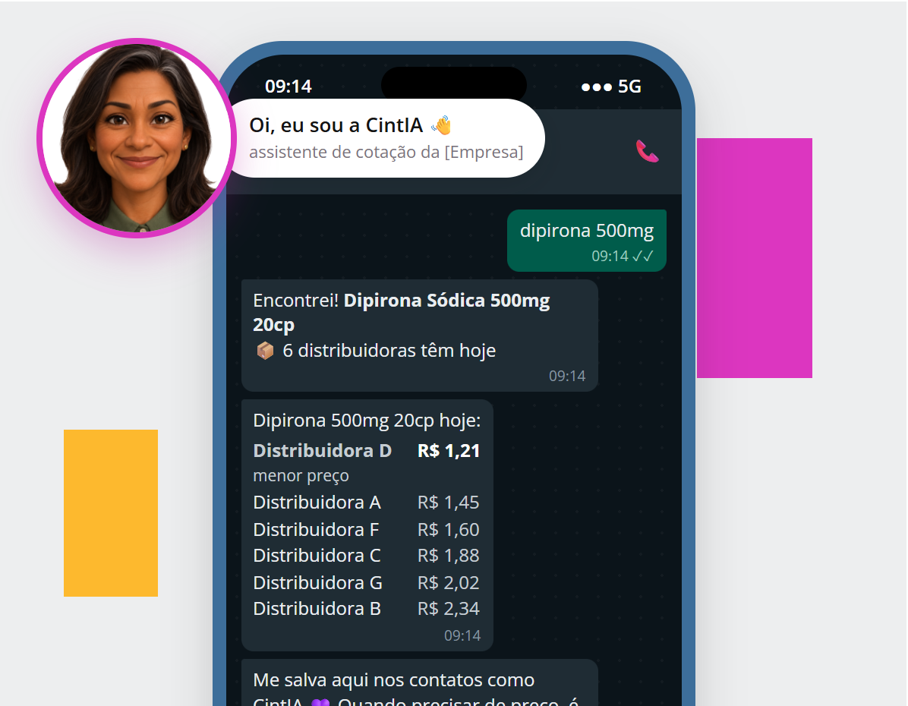

# CintIA · cotação de preço com IA no WhatsApp


**Case de produto para geração de demanda** · marketplace B2B de farmácia · 2026
Papel: produto e marketing (concepção, spec, persona, copy, prompts e métricas)

> Dados da empresa anonimizados: nome, domínios, pessoas, números internos e ferramentas aparecem genéricos.

---

## O problema

- O dono de farmácia vive no WhatsApp, não em landing page.
- A mídia paga gerava lead por formulário: caro por lead e com pouca qualificação.
- Comparar preço entre distribuidoras exigia abrir vários portais, um por distribuidora.

## A aposta

Trocar o formulário por uma conversa que **entrega valor antes de pedir qualquer coisa**.
A farmácia manda o nome do remédio e recebe, em segundos, o preço em todas as distribuidoras que têm o item, do menor para o maior. Sem app, sem login, de graça.
O CNPJ é pedido para liberar a cotação, e é aí que nasce o lead qualificado.

**Hipótese:** menos fricção gera custo por lead (CPL) menor que o da mídia paga, com um lead mais qualificado (CNPJ validado na conversa).

## ▶️ Teste você mesmo

| Mock interativo | O que mostra |
|---|---|
| **[Simulador da conversa](https://luizabragapro-alt.github.io/cintia-case/material/simulador-cintia.html)** | O celular com a CintIA. Escolha um cenário e toque nos botões: o painel ao lado explica o que acontece por trás em cada passo |
| [Todas as mensagens e saídas](https://luizabragapro-alt.github.io/cintia-case/material/saidas-cintia.html) | Cada bolha da conversa, as rotas por CNPJ e o FAQ respondido |
| [Fluxo completo](https://luizabragapro-alt.github.io/cintia-case/material/fluxo-cintia.html) | O fluxo de decisão, da primeira mensagem ao lead |
| [Da CintIA até o vendedor](https://luizabragapro-alt.github.io/cintia-case/material/cintia-ate-o-vendedor.html) | Como o lead chega ao comercial e o que é rastreado |
| [CintIA no site](https://luizabragapro-alt.github.io/cintia-case/material/cintia-no-site.html) | A seção do site que divulga a CintIA |

> Telefones, CNPJs, farmácias, distribuidoras e preços são fictícios.

## A conversa, na prática

### 1ª cotação: produto → CNPJ → preço em todas as distribuidoras

A farmácia manda o nome do remédio e recebe a faixa de preço **antes** de dar qualquer dado. O CNPJ é pedido para liberar quem tem o menor preço e, depois de validado, ela vê a lista completa. No fim vêm dois botões: **Quero o link** (vai para o cadastro com UTM) ou **Prefiro ajuda** (vai para um vendedor, que já recebe o contexto).

<table><tr>
<td width="50%" valign="top"><b>"Quero o link": cadastro sozinha</b><br></td>
<td width="50%" valign="top"><b>"Prefiro ajuda": passa para o vendedor</b><br></td>
</tr></table>

O handoff abre outra conversa no WhatsApp, com a mensagem já escrita: CNPJ, nome da farmácia e o produto cotado. A farmácia não precisa repetir nada.

<p align="center"></p>

### Quando ela não consegue (ou não quer) digitar

Quem manda áudio ou foto do falteiro não fica sem resposta. A CintIA admite o limite, oferece uma pessoa e pede o **CNPJ ou o nome da farmácia**. Quem não sabe o CNPJ de cabeça também é atendido.

<table><tr>
<td width="50%" valign="top"><b>Áudio e foto → ajuda humana</b><br></td>
<td width="50%" valign="top"><b>Voltou pelo contato salvo (CNPJ já guardado)</b><br></td>
</tr></table>

Na volta, a cotação sai com **uma resposta só** (o produto), porque o CNPJ já ficou salvo. Na segunda cotação, ela oferece uma pessoa uma única vez.

### Já é cliente

Se o CNPJ já tem conta, a CintIA não manda para vendas: direciona para a plataforma e para o suporte e segue cotando.

<p align="center"></p>

### Divulgação no site

<p align="center"></p>

## Como funciona

```
Mensagem → produto identificado → faixa de preço → pede CNPJ → valida na Receita
                                                                 │
   Rota A · farmácia na área atendida ──► MQL ──► cotação completa ──► convite ao cadastro
   Rota C · farmácia fora da área ─────► lista de espera da UF
   Rota D · não é farmácia ────────────► preço de referência e fim (zero lead)
```

- **Fricção mínima:** 2 respostas na primeira cotação (produto + CNPJ) e **1 da segunda em diante**. O CNPJ fica salvo no telefone.
- **3 saídas depois da cotação:** "Quero o link" (cadastro com UTM) · "Prefiro ajuda" (handoff para o vendedor, com contexto) · sem clique (sugere salvar o contato e segue cotando).
- **Lead sai pronto pro CRM:** CNPJ, razão social, cidade, produto cotado, faixa de preço, UTM e horário.

## Decisões de produto que importam

| Decisão | Por quê |
|---|---|
| **Persona, não "bot"**: CintIA tem nome, rosto e voz | É um contato que a farmácia salva e chama de novo. Contato com logo parece empresa; com rosto, parece gente. |
| **Salvar o contato é a métrica-chave** | A API oficial só permite conversa iniciada pelo usuário, então não existe remarketing. O contato salvo é o único canal de retorno. |
| **100% inbound** | Sem disparo, não tem risco de banimento, e a conversa iniciada pelo usuário custa pouco na API do WhatsApp. |
| **Imparcialidade** | Mostra número, nunca opinião. Não diz que uma distribuidora é melhor nem comenta preço de terceiro: distribuidora é parceira. |
| **MQL não é abordagem** | Ser lead qualificado não autoriza ligar. O vendedor só entra quando a farmácia pede. Ela promete isso por escrito, e quebrar a promessa queimaria o canal. |
| **Só pede o necessário** | Produto e CNPJ. Nada de formulário. |
| **Prompts editáveis sem deploy** | Persona, rotas e formato da cotação ficam num painel admin. Marketing ajusta tom e copy na hora, sem depender de dev. |

## Diferencial de mercado

No benchmark, **nenhum concorrente direto cotava dentro do WhatsApp**: eles usam o canal só para suporte ou venda com humano. A referência veio de fora do setor (conversational commerce B2B na América Latina).
Regra de comunicação: falar do que a gente faz ("cotação completa no WhatsApp"), nunca "somos os únicos".

## Métricas

- **CPL da conversa com CNPJ** contra o CPL da mídia paga atual.
- **Taxa de conclusão** (conversa → cotação entregue): meta ≥ 50%.
- **Cotações por farmácia/mês:** prova hábito, não só volume.
- **A métrica que prova a tese:** `conversas sem origem de anúncio ÷ total`. Se cresce, a CintIA virou canal próprio. Se fica em zero, é só mídia com outra roupa.
- **MQL → cadastro**, rastreado por UTM até o CRM.

## Lançamento

- Out/2026: no ar, no lugar de uma ferramenta gratuita anterior, na seção de recursos grátis do site.
- Soft launch: time interno testando, newsletter para a base e site. Mídia paga só depois de o fluxo estabilizar.

## Aprendizados até aqui

- **Gente manda foto e áudio**, não digita. Os primeiros casos que ela não atendeu foram fotos de lista: o próximo passo é aceitar foto e áudio.
- **Atribuição é o ponto frágil:** se o CNPJ já era lead de outra campanha, a origem antiga prevalece e a CintIA "some". Foi preciso tratar origem e tag próprias no CRM.
- O cadastro na plataforma tem muitos campos. O gargalo de conversão pode estar depois da conversa, não nela.

## O que tem neste repositório

| Arquivo | O que é |
|---|---|
| [`material/cintia-ura-whatsapp.md`](material/cintia-ura-whatsapp.md) | Spec completa da jornada v1: fluxo, mensagens, rotas, leads, métricas |
| [`material/cintia-faq.md`](material/cintia-faq.md) | FAQ e regras de tom e de imparcialidade |
| [`material/cintia-benchmark.md`](material/cintia-benchmark.md) | Benchmark de bots de WhatsApp B2B |
| `material/*.html` | Os mocks interativos (links clicáveis em **Teste você mesmo**, lá em cima) |
| [`material/avatar/`](material/avatar/) | Processo de criação do avatar (critérios, versões, prompts) |
| [`img/`](img/) | Prints das conversas usados neste README |
